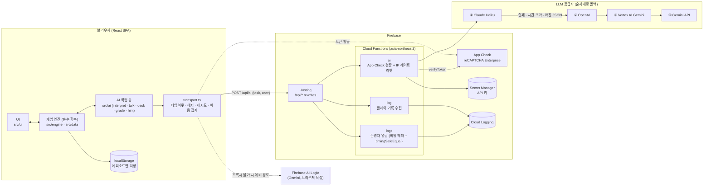

# 미해결 사건 파일

> 수사 문서를 읽고, AI가 연기하는 용의자에게 **자유롭게 질문하고 증거를 들이밀어** 거짓말을 무너뜨리는 웹 추리 게임 시리즈

**라이브:** https://crime-case-file.web.app (PC 전용, 최소 폭 1280px)

React 19 + TypeScript + Vite로 만든 클라이언트와 Firebase(Hosting · Cloud Functions · App Check)로 동작합니다. 개발 과정 대부분을 AI 코딩 도구와 함께 진행했고(바이브 코딩), 제품 안에서도 LLM이 용의자 연기 · 질문 해석 · 채점 · 힌트를 맡습니다.


### LLM 코드 먼저 보기

| 무엇 | 파일 |
|---|---|
| 서버 프록시 · 공급자 폴백(Claude → OpenAI → Vertex → Gemini) · 프롬프트 캐시 표시 | [`server/aiHandler.ts`](server/aiHandler.ts) (`runAi`, `viaClaude`) |
| 클라이언트 전송층 · 타임아웃 · 헤지 요청 · 재시도 · 비용 집계 | [`src/ai/transport.ts`](src/ai/transport.ts) (`callAI`) |
| 작업별 지시문 · JSON 스키마 · 캐시 칸 · 작은 모델 설정 | [`src/ai/prompts.ts`](src/ai/prompts.ts) (`TASKS`, `SMALL_MODEL_*`, `CACHE_BREAK`) |
| 대사 검사 파이프라인 · 판정 AI | [`src/ai/talk.ts`](src/ai/talk.ts) (`checkTalk`), [`src/ai/talkJudge.ts`](src/ai/talkJudge.ts) |
| 모델 비교 결과 (비용 $0.27 → $0.013) | [`design/model-eval-2026-10-17-talk/README.md`](design/model-eval-2026-10-17-talk/README.md), 스크립트 [`scripts/model-talk-compare.ts`](scripts/model-talk-compare.ts) |

---

## 목차

1. [주요 기능 / 게임 진행 방식](#주요-기능--게임-진행-방식)
2. [기술 스택](#기술-스택)
3. [아키텍처](#아키텍처)
4. [기술적 도전과 해결](#기술적-도전과-해결)
5. [AI 활용 / 바이브코딩 방식](#ai-활용--바이브코딩-방식)
6. [프로젝트 구조](#프로젝트-구조)
7. [로컬 실행](#로컬-실행)
8. [테스트](#테스트)
9. [회고 / 개선 계획](#회고--개선-계획)

---

## 주요 기능 / 게임 진행 방식

에피소드 1 「호텔 로베르 집무실 사건」(플레이타임 약 40~50분)과 5분짜리 튜토리얼 「마지막 상담」이 플레이 가능합니다. 에피소드 목록은 [`src/data/episodes.ts`](src/data/episodes.ts)에 있습니다.

1. **사건 개요 읽기** — 처음에는 개요 · 평면도 등 기본 자료 3건만 가지고 시작합니다.
2. **용의자와 자유 대화** — 정해진 선택지가 아니라 자연어로 묻습니다. AI가 각 인물의 말투 · 태도 · 숨긴 사실을 유지한 채 답합니다.
3. **근거 문장 모으기** — 자료 속 문장을 "근거 트레이"에 담아 두었다가 대화에 끌어다 놓아 제시합니다.
4. **수사팀에 요청** — "회장 휴대폰 통화 기록 뽑아 주세요"처럼 말로 요청하면 수사팀이 해석해 조사를 맡고, 1~5분 뒤 결과 문서가 도착합니다(동시 3건 제한).
5. **거짓말 무너뜨리기** — 결정적 근거를 들이밀면 범인의 거짓말이 단계별로 무너지고, AI가 대화를 읽어 **진술서**를 자동으로 다시 씁니다(정정 전후 표시).
6. **최종 보고서** — 범인 · 동기 · 경위를 서술형으로 쓰면 AI 채점관이 요점별로 채점합니다.
7. **힌트** — 막히면 엔진이 다음 목표를 정하고, AI가 지금까지의 진행을 읽어 아직 하지 않은 일만 권합니다.

그 밖에 진행 상황 자동 저장(에피소드별), 저장 링크 내보내기, 라디오 BGM · 효과음(Web Audio 합성), 손그림 느낌 UI(캔버스 · SVG 스케치 렌더러)가 있습니다.

## 기술 스택

| 영역 | 기술 |
|---|---|
| 프론트엔드 | React 19, TypeScript (strict), Vite 8, CSS (디자인 토큰 · 손그림 스케치 컴포넌트) |
| 상태 관리 | `useReducer` + Context (`src/engine/state.tsx`), `useSyncExternalStore` (계정 상태), localStorage 저장 |
| 백엔드 | Firebase Cloud Functions v2 (Node 22, asia-northeast3), esbuild 번들 |
| 인프라 / 보안 | Firebase Hosting (rewrites로 `/api/*` → Functions), App Check (reCAPTCHA Enterprise), Secret Manager, Cloud Logging |
| AI | Anthropic Claude (기본: Haiku, JSON Schema 출력 · 프롬프트 캐시), 예비 경로: OpenAI Responses API, Vertex AI Gemini, Gemini API, Firebase AI Logic |
| 인증 / 결제 (로컬 개발 단계) | Firebase Auth (Google), 토스페이먼츠 SDK (테스트 키) |
| 테스트 | `node:test` + tsx (게임 로직 84개), Storybook 10 + Vitest 브라우저 모드 + Playwright (스토리 22개), AI 평가 스크립트 (`scripts/*-eval.ts`) |
| 개발 도구 | Claude Code 등 AI 코딩 도구, Storybook (addon-a11y · addon-mcp) |

## 아키텍처



- **같은 서버 코드를 두 곳에서 사용**: [`server/aiHandler.ts`](server/aiHandler.ts)를 배포용 Cloud Function([`functions/src/index.ts`](functions/src/index.ts))과 로컬 Vite 플러그인([`dev/aiProxy.ts`](dev/aiProxy.ts))이 함께 import합니다. 로컬과 배포의 동작 차이가 생기지 않습니다.
- **지시문은 서버가 고름**: 클라이언트는 작업 이름(`task`)과 사용자 프롬프트만 보내고, 시스템 지시문 · JSON 스키마는 서버가 [`src/ai/prompts.ts`](src/ai/prompts.ts)의 `TASKS`에서 고릅니다. 공개된 프록시를 범용 LLM 프록시로 쓸 수 없습니다.
- **Firestore는 아직 쓰지 않음**: 게임 진행은 브라우저 localStorage에 저장합니다. 결제 · 이용권 로직([`server/billing.ts`](server/billing.ts))은 저장소와 분리된 순수 로직으로 두었고, 지금은 로컬 JSON 파일에 붙여 개발 중입니다(배포 시 Firestore 연결 예정).

## 기술적 도전과 해결

### 1. "AI는 해석과 연기, 판정은 엔진" — LLM을 게임 규칙에서 분리하기

**문제**: LLM에게 용의자 연기를 통째로 맡기면 근거 없이 자백하거나, 숨겨야 할 사실을 흘리거나, 없는 증거 ID를 지어냅니다. 추리 게임에서는 치명적입니다.

**해결**: 역할을 나눴습니다.
- AI는 플레이어의 말을 **정해진 ID 목록 안에서** 분류하고(`interpret`, `team`, `coldOrder`), 인물의 말투로 대사를 씁니다(`talk`, `voice`).
- 어떤 자료를 줄지, 거짓말이 무너졌는지, 정답인지는 **순수 함수 엔진**이 정합니다 ([`src/engine/logic.ts`](src/engine/logic.ts), [`src/engine/investigation.ts`](src/engine/investigation.ts), [`src/cold/engine.ts`](src/cold/engine.ts)).
- 채점도 AI는 "요점마다 담음 · 애매함 · 없음"만 표시하고, 정답 · 세모 · 오답은 엔진이 가릅니다 ([`src/ai/grade.ts`](src/ai/grade.ts)). 힌트도 다음 목표는 엔진(`nextHint`)이 고르고 AI는 문장만 씁니다 ([`src/ai/hint.ts`](src/ai/hint.ts)).
- 수사팀 요청 · 채점 · 힌트 등은 **낱말 기반 예비 경로**가 있고, 대화는 실패한 질문을 그대로 다시 보낼 수 있어 AI가 응답하지 않아도 게임이 멈추지 않습니다.

### 2. 대사 검사 파이프라인 — 누설 · 거짓 자백 막기

[`src/ai/talk.ts`](src/ai/talk.ts)의 `checkTalk`가 인물의 답을 화면에 보이기 전에 검사합니다.
1. **낱말 검사**: 숨긴 낱말 · 시각, 이미 거둔 거짓말의 반복, 근거 없는 자백, 내부 ID 노출. 형사가 먼저 다른 말로 꺼낸 사실을 되받는 것은 누설이 아닙니다(`SAME_AS` 동의어 묶음).
2. **판정 AI** ([`src/ai/talkJudge.ts`](src/ai/talkJudge.ts)): 숨기는 단계가 남은 인물의 답 중 시인할 낌새가 있는 것만(`mayConcede`) 다시 읽어 "트로피로 머리를 쳤습니다"처럼 **말을 바꾼 자백**을 잡습니다. 판정 AI는 항목별로 시인 여부만 표시하고, 받아들일지는 엔진이 정합니다.
3. 걸리면 **고칠 점을 붙여 다시 요청**하고(최대 4회), 모두 실패하면 엔진이 미리 정해 둔 안전한 대사(`safeTalk`)로 답합니다. 상태는 바뀌지 않습니다.
4. 사건마다 다른 규칙은 [`src/data/hotelTalkRules.ts`](src/data/hotelTalkRules.ts)로 분리해, 검사 코드는 사건과 무관하게 재사용합니다 (형식: [`src/ai/talkRules.ts`](src/ai/talkRules.ts)).

### 3. 모델 선택과 비용 — 평가로 Sonnet에서 Haiku로 전환

처음에는 Claude Sonnet으로 시작했고, 같은 24턴 대화 시나리오를 여러 모델로 돌려 비교했습니다 ([`design/model-eval-2026-10-17-talk/README.md`](design/model-eval-2026-10-17-talk/README.md), 스크립트 [`scripts/model-talk-compare.ts`](scripts/model-talk-compare.ts)).

| 구성 | 응답 중앙값 / 최대 | 핵심 증거 앞 인정 | 24턴 비용 |
|---|---|---|---:|
| Sonnet 원래 프롬프트 | 2.6초 / 6.3초 | 1/1 | $0.27 |
| Haiku 원래 프롬프트 | 2.0~2.1초 / 9~11초 | 2/2 (진술서 기록 누락) | $0.018~0.022 |
| **Haiku 맞춤 프롬프트 (최종)** | **1.7~2.0초 / 9~14초** | **3/3** | **$0.013** |

- Haiku가 놓치던 규칙(진술서 항목 기록, 수사팀 조사 시작)을 **작은 모델 전용 점검 목록**(`SMALL_MODEL_CHECK`)으로 답 직전에 다시 짚게 했습니다.
- 작업별로 생각 수준을 조정했습니다(`SMALL_MODEL_EFFORT`, `SMALL_MODEL_NO_THINKING`). 예: 진술서 작업은 생각을 꺼도 채점이 같아(8/8) 중앙값 7초 → 4초. 판정 AI도 생각을 끄니 judge-eval 135/135 유지에 중앙값 1.8초 → 1.3초 (측정 기록은 [`src/ai/prompts.ts`](src/ai/prompts.ts)의 해당 설정 주석).
- 채점은 effort low에서 Sonnet과 일치율 84~89%였지만 medium에서 96~99%라 medium으로 유지했습니다.
- 그 결과 **Sonnet 대비 약 1/20 비용**으로 같은 시나리오를 통과했습니다. OpenAI 소형 모델도 같은 스크립트로 비교했는데, 입력 토큰은 더 적어도 캐시 적중률(35~45% vs Haiku 약 95%) 차이로 Haiku가 가장 쌌습니다.

### 4. 프롬프트 캐시 설계 — 칸 단위 TTL

프롬프트를 구분자(`CACHE_BREAK`)로 칸을 나눠, 오래 변하지 않는 칸부터 앞에 둡니다 ([`src/ai/prompts.ts`](src/ai/prompts.ts), [`server/aiHandler.ts`](server/aiHandler.ts)).
- 시스템 지시문: 1시간 캐시 / 인물 설정: 1시간 / 인물 상황 · 자료 목록: 5분 / 최근 대화 · 질문: 캐시 없음
- 칸이 실제로 얼마나 자주 바뀌는지 플레이 기록으로 측정해(`scripts/cache-churn.ts`), 저장 단가가 두 배인 1시간 캐시가 오히려 손해인 칸은 5분으로 두었습니다. 플레이 기록 두 판으로 칸 구성 7가지를 비교해 `talk` 비용을 약 20% 줄였습니다(Sonnet을 쓰던 시기에 측정, `TASKS.talk` 주석). Haiku로 바꾼 뒤에는 칸을 더 쪼개도 차이가 거의 없었습니다. 최종 구성에서 Haiku 대화의 캐시 적중률은 약 93~95%입니다.
- 플레이어 입력에 구분자가 섞여 칸이 바뀌는 것을 막습니다(`noBreak`).

### 5. 세계관을 넓힐 때 RAG가 나을까 — 다섯 방식 비교

세계관을 약 10배(54조각, 약 1만 3천 자)로 넓힌다고 가정하고, 지금처럼 인물이 아는 내용을 캐시 칸에 통째로 넣는 방식과 임베딩 RAG(OpenAI `text-embedding-3-small` + 코사인 유사도)를 Haiku로 비교했습니다. 방식마다 24턴 테스트 3판, 세계관 질문 24개를 돌렸습니다.

| 방식 | 24턴 판정 17항목 (3판) | 확장 세계관 질문 | 지금 문서 질문 | talk 18턴 비용 |
|---|---|---|---|---|
| 통째 주입 (full) | 49/51 | **30/30** | 23/24 | $0.0158 |
| RAG 4조각 추가 (rag) | 49/51 | 27/30 | 23/24 | $0.0159 |
| 지금 문서까지 RAG로 (ragDoc) | 51/51 | 1/30 | 23/24 | $0.0174 |

- 통째 주입이 더 정확하고 비용은 같아 **지금 구조를 유지**했습니다. RAG가 놓친 질문은 구어체라 검색이 조각을 찾지 못한 경우였습니다.
- 지금 문서를 RAG로 옮기면, 검색이 놓친 사실을 "모른다"고 하지 않고 지어냈습니다. 찾아 넣은 조각은 매 턴 바뀌어 캐시를 못 쓰므로 비용도 15~20% 늘었습니다.
- 게임 판정(인정 · 건넴)에 쓰는 정보는 어느 방식에서도 고정 칸에 남아 있어 판정은 깨지지 않았습니다.

### 6. 지연 · 장애 대응 — 헤지 요청과 다중 공급자 폴백 (스트리밍 없이)

응답은 JSON Schema 구조화 출력이라 스트리밍 대신 **요청 신뢰성**에 집중했습니다 ([`src/ai/transport.ts`](src/ai/transport.ts)의 `callAI`).
- 시도 하나에 기본 25초, 전체 1분 예산, 시도는 최대 4번. **작업별 기준 시간(질문 해석 4.5초, 인물 대화 7초 등) 안에 답이 없으면 한 번 더 보내고 먼저 온 올바른 답을 사용**, 나머지는 `AbortController`로 취소합니다. 경로가 하나뿐이면 헤지 요청이 비용을 두 배로 만들 수 있어 최소 7초를 기다립니다.
- 깨진 JSON이나 검사에 걸린 답도 실패로 보고 재시도합니다. 검사에 걸린 답은 고칠 점을 프롬프트 끝(캐시하지 않는 칸)에 붙여 다시 보냅니다(`Rejected`).
- 서버는 Claude → OpenAI → Vertex → Gemini 순서로 폴백합니다. 한 공급자의 크레딧 소진이나 장애가 게임을 멈추지 않습니다.
- 끝내 실패하면 대화에 **"응답을 받지 못함 / 다시 보내기"** 버튼으로 남고, 판정은 해석을 받은 뒤에만 하므로 다시 보내도 인정 · 자료 공개가 두 번 일어나지 않습니다.
- 콘솔의 `aiStats()`로 경로별 성공률 · p50/p90 · 토큰 · 비용(USD)을 바로 봅니다.

### 7. 남용 방지와 운영 로그

- **App Check**: `/api/ai`, `/api/log`는 App Check 토큰을 검증합니다. 만료 토큰은 클라이언트가 한 번 새로 받아 재시도합니다. 로컬 디버그 토큰은 `define`으로 개발 서버에서만 주입해 배포 번들에 들어가지 않게 했습니다 ([`vite.config.ts`](vite.config.ts)).
- **레이트 리밋**: IP당 분당 요청 수 제한(AI 40회, 로그 60회). 입력 길이 상한(`MAX_USER_PROMPT`, `MAX_TALK_INPUT`)과 본문 크기 · ID 형식 검증.
- **운영자 로그 열람** (`/api/logs`): Secret Manager의 키와 요청 헤더를 `timingSafeEqual`로 비교하고, 실패가 10분 안에 10회를 넘으면 차단합니다. 서버에서 판(run) 단위로 요약해 내려 보냅니다([`server/playSummary.ts`](server/playSummary.ts)).
- 플레이 기록은 무작위 기기 ID · 판 ID로 묶어 Cloud Logging에 남기고, 이를 다시 플레이테스트 분석에 썼습니다.

### 8. 상태 저장과 복원

- 에피소드마다 저장 키를 분리하고(`gold-trophy-save-v1`, `cold-case:twice-dead`) 버전 · 사건 ID가 다르면 무시합니다 ([`src/engine/state.tsx`](src/engine/state.tsx)).
- 새로고침 중 응답을 기다리던 메시지는 "응답을 받지 못함"으로 바꿔 다시 보낼 수 있게 하고, 진행 중이던 수사팀 조사는 시간이 지났으면 복원 즉시 결과가 들어옵니다.
- **저장 링크**: 진행 기록을 `CompressionStream`으로 압축해 URL의 `#save=` 뒤에 담습니다. 해시는 서버로 전송되지 않습니다 ([`src/engine/saveLink.ts`](src/engine/saveLink.ts)).

## AI 활용 / 바이브코딩 방식

### (a) 개발 도구로서의 AI

- **기획 → 인수인계 문서 → 구현**: 사건 설정집 · 시간표 · 거짓말 단계 · 수용 검사 기준을 먼저 문서로 확정하고, AI 코딩 도구에 넘길 인수인계 문서를 따로 썼습니다 ([`design/CLAUDE_IMPLEMENTATION_HANDOFF.md`](design/CLAUDE_IMPLEMENTATION_HANDOFF.md), [`design/hotel-gold-trophy-case.md`](design/hotel-gold-trophy-case.md)). "무엇을 만들지"는 사람이 정하고, 구현은 AI와 함께 진행했습니다.
- **플레이테스트 루프**: 구현 → 플레이(사람 · AI) → 리뷰 문서 → 수정을 반복했습니다. `design/playtest-*` 폴더 9개에 각 회차의 플레이 로그 · 타이밍 · 막힌 지점 · 결정 사항이 남아 있습니다 (예: [`design/playtest-2026-10-16/review.md`](design/playtest-2026-10-16/review.md)).
- **AI 플레이어 + AI 심사관**: [`scripts/ai-playtest.ts`](scripts/ai-playtest.ts)는 성향을 부여한 플레이어 AI(Haiku)가 게임과 같은 검사 로직으로 자유 플레이하고, 상위 모델이 대화 전문과 진상을 읽어 어색한 대사를 목록으로 남깁니다. 정해진 시나리오로는 못 찾는 문제를 찾는 용도입니다.
- **회귀 평가 스크립트**: 프롬프트를 바꿀 때마다 정답을 아는 사례로 자동 채점했습니다 — `interpret-eval`, `judge-eval`, `talk-eval`, `team-eval`, `cold-order-eval`, `cold-talk-eval`, `episode-convo`(장면 52판 중 문제 1건, [`design/convo/README.md`](design/convo/README.md)) 등. 비용 장부(`design/convo/ledger.json`)로 평가 비용까지 추적했습니다.
- **모델 비교 문서**: [`design/model-eval-2026-10-13`](design/model-eval-2026-10-13/README.md) (해석 정확도 · 지연 · 비용, Gemini · Claude 계열 비교), [`design/model-eval-2026-10-17-talk`](design/model-eval-2026-10-17-talk/README.md) (대화 · 진술서 · 채점 · 힌트).
- **역할 분담에 대한 솔직한 정리**: 코드 대부분은 AI가 작성했습니다. 제가 집중한 것은 (1) 게임 규칙과 사건 설계, (2) AI와 엔진의 책임 경계 설계, (3) 평가 기준과 측정, (4) 결과물 검증과 방향 결정입니다.

### (b) 제품 안의 AI

| AI 작업 (`TASKS`) | 역할 | 실패 시 |
|---|---|---|
| `interpret` | 플레이어 말을 질문 · 지적 · 잡담 등으로 분류하고 ID 목록에서 근거 · 주제를 고름 | "다시 보내기"로 남김 |
| `talk` / `talkPlan` | 용의자 연기 + 진술서 기록 · 인정할 단계 제안 | 통신 실패: "다시 보내기" / 검사 4회 실패: 준비된 대사 |
| `talkJudge` | 숨긴 사실을 시인했는지 판정 | 낱말 검사만 |
| `desk` / `team` | 수사팀: 자연어 조사 요청 해석 | 낱말 매칭 |
| `statement` | 대화를 읽고 진술서(정정 전후 포함) 다시 쓰기 | 이전 진술서 유지 |
| `grade` | 서술형 보고서 요점 채점 | 낱말 채점 |
| `hint` | 엔진이 정한 다음 목표를 플레이어 맥락에 맞게 표현 | 미리 써 둔 단계별 힌트 |
| `coldOrder` / `coldTalk` | 프로토타입 `/cold`: 반장 지시 · 조사실 대화 해석 | 메뉴 · 버튼 |

## 프로젝트 구조

```
├─ src/
│  ├─ ai/          AI 작업: 프롬프트·스키마(prompts.ts), 전송층(transport.ts), 대사 검사(talk.ts) 등
│  ├─ engine/      게임 엔진: 상태·저장(state.tsx), 판정(logic.ts), 수사 요청(investigation.ts), 힌트
│  ├─ data/        사건 데이터: 인물·자료·진술·논파 조건·사건별 대사 규칙
│  ├─ ui/          화면 컴포넌트 (Hub, Interrogation, TeamView, Report, Result …)
│  ├─ sketch/      손그림 스타일 렌더러 (캔버스·SVG)
│  ├─ audio/       Web Audio 효과음·라디오
│  ├─ cold/        차기작 프로토타입 「두 번 죽은 남자」 (/cold)
│  ├─ account/     Google 로그인·이용권 (로컬 개발 단계)
│  ├─ logs/        운영자 화면 (플레이 기록 열람)
│  └─ stories/     Storybook 스토리
├─ server/         AI 프록시 본체(aiHandler.ts), 결제 로직, 로그 요약 — Functions와 로컬이 공유
├─ functions/      Firebase Cloud Functions 진입점 (ai, log, logs)
├─ dev/            Vite 개발 서버용 AI 프록시·결제 플러그인
├─ scripts/        모델 비교·평가·AI 플레이테스트·에셋 처리 스크립트
├─ tests/          node:test 게임 로직 테스트
└─ design/         기획서, 사건 설정집, 플레이테스트 리포트, 모델 평가 기록
```

## 로컬 실행

요구 사항: Node.js 22 이상 (일부 Firebase 패키지는 24 이상 권장 경고가 있음)

```bash
npm install
cp .env.local.example .env.local   # 필요한 값만 채운다 (아래 참고)
npm run dev                         # http://localhost:5173
```

- **AI 없이**: 키가 없으면 Firebase AI Logic(Gemini, 브라우저 직접) 경로를 시도하고, 그것도 안 되면 낱말 기반 예비 경로로 플레이됩니다.
- **Claude로**: `.env.local`에 `ANTHROPIC_API_KEY`를 넣으면 Vite 플러그인([`dev/aiProxy.ts`](dev/aiProxy.ts))이 배포와 같은 서버 코드로 `/api/ai`를 처리합니다. 키는 Node 프로세스 안에서만 읽고 브라우저로 보내지 않습니다. 파일을 요청마다 다시 읽으므로 재시작이 필요 없습니다.
- 로컬에서는 이용권 확인이 켜져 있습니다. AI 평가 스크립트 등에서 끄려면 `.env.local`에 `PAYWALL=off`.
- 프로토타입: http://localhost:5173/cold

기타 스크립트:

```bash
npm run typecheck          # tsc -b
npm run build              # 타입 검사 + 프로덕션 빌드 (dist/)
npm run storybook          # http://localhost:6006
npx tsx scripts/judge-eval.ts   # AI 평가 예시 (ANTHROPIC_API_KEY 필요, 비용 발생)
```

### 배포 (참고)

```bash
cp functions/.env.example functions/.env       # 비밀 값이 아닌 모델 설정
firebase functions:secrets:set ANTHROPIC_API_KEY
firebase functions:secrets:set OPENAI_API_KEY
firebase functions:secrets:set LOG_VIEWER_KEY
npm run build
firebase deploy --only functions,hosting
```

Cloud Functions는 Blaze 요금제가 필요합니다. 함수 빌드(esbuild)는 배포 때 자동으로 실행됩니다. 웹 앱 설정과 App Check 사이트 키([`src/firebaseConfig.ts`](src/firebaseConfig.ts))는 공개를 전제로 한 값입니다.

## 테스트

```bash
npm test                   # node:test — 사건 논리(지적 조건, 자료 공개 순서, 보고서 판정), 결제 로직, 한국어 조사 처리 등 84개
npm run test-storybook     # Vitest 브라우저 모드 + Playwright(Chromium)로 Storybook 스토리 22개 렌더링 검사
```

- `tests/judgement-paraphrase.test.ts`: 형사의 다양한 말투에 엔진의 [추궁 판정]이 맞게 붙는지 AI 없이 검사합니다.
- `tests/twice-dead.test.ts`: 프로토타입 사건의 시나리오(선행 조건 · 시간 · 결말)를 검증합니다.
- LLM 품질은 단위 테스트 대신 `scripts/*-eval.ts` 평가 스크립트로 측정합니다(실제 API 호출).

## 회고 / 개선 계획

**잘한 점**
- LLM의 비결정성을 게임 규칙에서 분리한 구조 덕분에, 모델을 Sonnet → Haiku로 바꾸거나 공급자를 추가해도 게임 판정은 흔들리지 않았습니다.
- "느낌"이 아니라 평가 스크립트와 비용 장부로 프롬프트 · 모델을 결정했습니다.

**아쉬운 점 / 개선 계획**
- 사건 데이터가 `src/data/*`에 에피소드 1 기준으로 묶여 있어, 다음 에피소드를 위해 에피소드별 모듈로 분리해야 합니다.
- 레이트 리밋이 인스턴스 메모리 기반이라 인스턴스가 늘면 느슨해집니다 → Firestore · Redis 기반 카운터 또는 App Check 재생 방지 토큰 검토.
- 메인 번들이 500KB를 넘습니다 → 화면 단위 코드 분할.
- ESLint가 설정되어 있지 않습니다 → ESLint/Prettier와 CI(타입 검사 · 테스트) 추가.
- 결제 · 이용권은 로컬 개발 단계입니다 → Cloud Functions + Firestore로 이전.
- E2E 테스트가 없습니다 → Playwright로 튜토리얼 완주 시나리오 추가(AI는 목 응답).
- 모바일 미지원(PC 전용) → 문서 · 대화 2단 레이아웃의 반응형 재설계.
