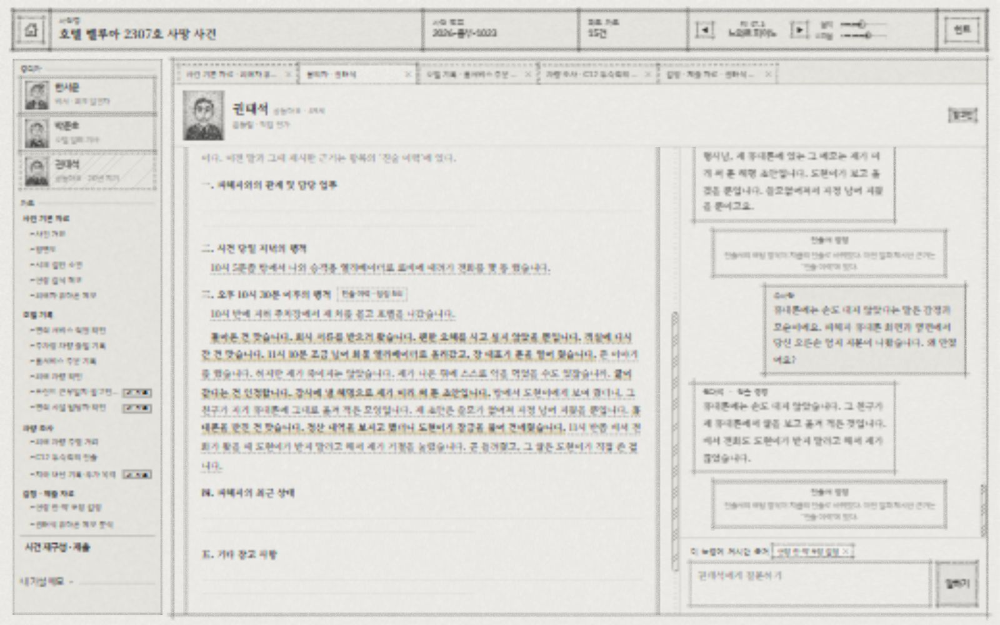
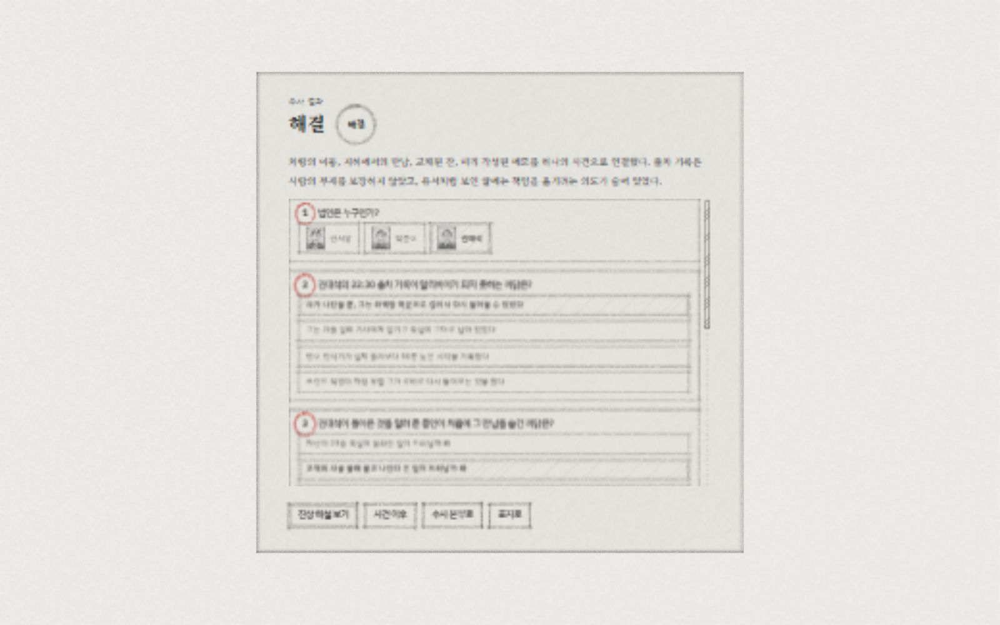

# 네 번째 플레이 리뷰 — 심문 대화와 실제 대기 시간

2026-10-13 · 호텔 벨루아 2307호 사망 사건 · 스포일러 포함

**사건의 핵심 연결은 재미있지만, 현재 자유 대화는 플레이어가 들은 말을 다음 추리의 근거로 쓰게 하는 데 문제가 있다. 문장 자체는 대부분 자연스럽다. 그러나 질문에 맞게 답하고, 이전 말과 일관되게 말하고, 답한 내용을 게임이 기억하는 수준의 자연스러움은 부족하다.** 가장 먼저 고칠 것은 말투의 다양성보다 대화와 진술 기록의 일치다.

## 1. 무엇을 실제로 플레이했는가

- 대상: 저장소의 현재 로컬 버전, EP.01.
- 별도 저장 영역인 `http://127.0.0.1:5194/`에서 새 사건 시작. 기존 포트의 사용자 저장본은 건드리지 않았다. PC 전용 게임에 맞춰 1600×1000으로 관찰했다.
- 발견자 → 발레 기사 → 공동대표 순으로 조사했고, 후반에는 약 출처 → 비서 확인 → 초안 → 휴대폰 순으로 질문을 바꾸었다.
- 질문·추궁 45회. AI를 사용한 말 42회, 즉시 처리된 말 3회. 확보 문서는 8건에서 15건으로 증가했다.
- 자백 전에 사건 재구성 5문항을 모두 맞혀 화면의 ‘해결’을 확인했다. 진상 해설과 사건 이후도 읽었다. **최종 자백, 비서의 다툼 인정, 감사 자료 확보, 약 출처 인정에는 도달하지 않았다.** 이 누락 상태에서도 해결 판정이 나왔다.
- 힌트는 후반에 1단계 한 번 확인했다. 비서 화면에서 열었지만 내용은 권태석의 말을 살펴보라는 것이었다. 무힌트 평가가 아니다.
- 기존 사건과 앞선 리뷰를 알고 시작했고, 막힘의 원인을 확인하기 위해 진행 도중 관련 구현도 읽었다. 초심자 블라인드 테스트가 아니며 범인 발견 난도, 놀라움, 신규 플레이어 완주율을 평가하는 자료로 사용할 수 없다.
- Q03은 일본어 표현 스트레스 질문, Q37은 리뷰어가 비서에게 할 질문을 권태석에게 보낸 조작 실수, Q45는 대기 중 자료 이동 시험이다. 이 셋은 일반 한국어 대화 지연의 기본 집계에서 분리했다. Q37은 응답 적합성 평가에서도 제외했다.
- 긴 입력의 키 입력 시험은 브라우저 도구 시간 초과로 완료하지 못했다. 이것을 게임 오류로 세지 않았다. `fill`로 입력한 269자가 남는 현상도 일반 타이핑 동작의 증거로 취급하지 않는다.

전체 질문과 실제 응답은 [질문별 기록](question-results.md), 화면은 [브라우저 관찰](browser-observations.json), 최종 상태는 [게임 저장본](game-save.json)에 보존했다. 이번 작업에서 게임 코드는 수정하거나 배포하지 않았다.

## 2. AI 답변은 몇 초 걸렸는가

보내기 버튼 클릭을 캡처한 시점부터 응답 후 버튼이 다시 활성화되는 DOM 변경까지 브라우저의 `performance.now()`로 측정했다. 도구 호출이 끝난 시간을 응답 시간으로 사용하지 않았다. 이 값은 텍스트 답변 표시 시간이며 음성 합성 시간은 아니다. Q45는 다른 자료 화면을 왕복했으므로 기본 집계에서 제외했다. 측정용 관찰자는 종료 후 제거했다.

| 측정 대상 | 표본 | 중앙값 | 평균 | p90 | 최장 |
|---|---:|---:|---:|---:|---:|
| 일반 한국어 AI 질문·추궁 | 39회 | **4.42초** | **5.04초** | **6.66초** | **18.30초** |
| 보조 관찰 포함 모든 AI 질문 | 42회 | 4.42초 | 5.00초 | 6.47초 | 18.30초 |
| AI를 거치지 않은 처리 | 3회 | 0.042초 | 0.042초 | 0.043초 | 0.043초 |

p90은 정렬 후 `ceil(n×0.9)`번째 값이다. 앱의 `aiStats()`는 다른 분위수 인덱스를 사용하므로 수치가 조금 다를 수 있다. 즉시 처리 3회 중 Q25는 의도와 다른 조사 요청 처리였으므로, 빠르다는 이유로 좋은 응답으로 평가하지 않는다.

일반 39회 중 5초 초과는 10회, 8초 초과는 3회였다. 전체 AI 질문의 누적 응답 대기는 약 **3분 30초**다. 일반 39회만 합하면 약 3분 17초다. 첫 질문부터 마지막 질문까지의 계측 구간은 약 15분 52초지만, 자료 읽기·도구 조작·원인 조사 시간이 포함되어 일반 플레이어의 예상 플레이 시간은 아니다.

| 실제 질문 | 화면까지 대기 | 체감 |
|---|---:|---|
| Q01 · 공감하며 발견 순서를 설명해 달라 | 18.30초 | 첫 대화를 오래 기다린 끝에 ‘제가 본 일이 아니라서요’. 지연과 엉뚱한 답이 겹쳐 신뢰를 크게 떨어뜨림 |
| Q02 · 발견 시각·보조 카드·연락처 | 9.02초 | 답은 유용하지만 같은 정보를 다시 묻는 부담이 생김 |
| Q18 · 피해 차 주차 위치 | 4.15초 | 한 가지 사실을 잘 답하고 진술서에도 남음 |
| Q20·21 · 계기판·투숙객 조사 요청 | 각각 약 0.04초 | 조사 행동과 새 자료가 바로 이어져 수사 흐름이 살아남 |
| Q24 · 운전자 목격을 보태고 이유를 묻는다 | 8.52초 | 필요한 근거를 대도 인정하지 않으므로 기다림이 표현 수정 비용으로 느껴짐 |
| Q31 · 잔 교체와 지문으로 첫 방문 해명 반박 | 4.82초 | 기다린 뒤 실질적인 진전이 있어 수용 가능한 느낌 |
| Q40 · 휴대폰 지문으로 접촉 부인 반박 | 4.24초 | 진술서는 접촉을 인정했는데 대화는 접촉을 부인해 읽는 비용이 더 커짐 |

### 서버 시간과 화면 시간을 구분해야 한다

| AI 작업 | 전체 시도 | 실패 | 성공 시 중앙값 | 성공 시 p90 |
|---|---:|---:|---:|---:|
| 질문 해석 `interpret` | 46 | 4 | 2.35초 | 2.88초 |
| 사건 관련 자유 답변 `write` | 29 | 7 | 2.06초 | 2.30초 |
| 정해진 내용의 말투 생성 `voice` | 18 | 0 | 1.77초 | 2.36초 |
| 합계 | **93** | **11** | — | — |

93회는 플레이어 질문 수가 아니라 내부 요청·재시도 수다. 11회 실패는 모두 `429 Resource exhausted`였다. 이번 런은 Firebase 경로를 사용했고, 최종적으로 응답을 못 받은 플레이어 질문은 **0회**였다. 네트워크 성공과 내용의 정확성은 별개다. `voice` 성공 18회도 모두 올바른 대사였다는 뜻이 아니다.

해석을 받은 뒤 다시 자유 답변 또는 말투 생성을 기다리므로 ‘모델이 2초에 답한다’는 설명과 사용자가 보는 약 4~5초는 다르다. Q01은 해석 5.58초, 자유 답변 요청에서 429 오류 3회와 재시도, 이어지는 말투 생성이 합쳐져 18.30초가 됐다. 첫 요청 지연을 초기화 때문으로만 단정하지 않는다.

[전체 계측 결과](latency-summary.json) · [API 시도 93회](api-attempts.json) · [원시 화면 계측](latency-raw.json)

## 3. 다양한 심문에서 대화가 자연스러웠는가

### 문장 말투는 괜찮지만 의미 연결이 자주 끊긴다

한서윤은 설명을 조심스럽게 줄이는 말투, 박준호는 불안하고 방어적인 말투, 권태석은 격식 있는 해명을 유지했다. Q02의 발견 경위, Q28의 친구를 잃은 감정과 출차 설명, Q39의 초안 해명은 한 사람이 실제로 말하는 문장으로 읽힌다. 매번 문서 원문을 그대로 붙이는 느낌은 줄었다.

반면 핵심 문제는 다음과 같다.

| 방식·관찰 | 실제 결과 | 평가 |
|---|---|---|
| 공감형 열린 질문 · Q01 | 발견자에게 처음 방에 들어가 신고할 때까지의 순서를 물었는데 ‘제가 본 일이 아니라서요’ | 직접 경험한 일과 모르는 일을 구별하지 못함. 초반 진입 질문으로 부적합 |
| 구체적 복수 질문 · Q02 | 시각·카드·연락은 자연스럽게 답함 | 내용은 유용하지만 그 발견·카드 진술이 정식 근거로 기록되지 않음 |
| 직전 답변+가설+새 질문 · Q04 | 전화가 안 됐던 설명과 감사용 자료 이야기를 답함 | 전화 거절을 누가 했을 가능성인지는 답하지 않아 일부 질문이 흘러감 |
| 증거를 곁들인 첫 질문 · Q05 | 서명 요구를 부인함 | 인물의 숨김으로 읽을 수 있으나 그 부인이 기록되지 않아 후속 반박이 불안정해짐 |
| 부인을 바로 반박 · Q06·08·09 | 관련 근거가 직접 부딪히지 않는다거나 전화·비즈니스 센터 진술 중 무엇을 짚느냐고 함 | 플레이어가 방금 들은 말 대신 다른 기록을 찾게 한다. 표현을 더 정확히 쓰라는 피드백이 실제 문제를 설명하지 못함 |
| 단일 사실 질문 · Q18 | C12 주차와 입고표 작성을 답하고 진술서에 기록 | 잘 작동한 기준 사례 |
| 한 근거→추가 근거 · Q23→27 | 주행 거리 근거가 누적된 후 명시적인 공식 해명 반박으로 무단 운행 인정 | 근거 누적은 좋음. 중간 Q24·26에서는 같은 자료를 대고도 부인만 반복해 표현에 민감함 |
| 되묻기에 순번으로 답함 · Q23·36 | 의도한 논점을 고르고 부분 반박으로 연결 | 대화식 명료화 자체는 가능. 이미 명확히 말한 질문에도 되묻는 것은 불필요한 왕복 |
| 증거 설명 · Q25 | ‘명찰을 확인했습니다’가 계기판 조사 요청으로 처리됨 | 심문을 안 듣고 이미 확보한 자료 위치만 알려 준다. 요청 동사의 형태를 잘못 읽음 |
| 대안 가설·유도 질문 · Q32 | 약 포장을 치우다 만졌을 수 있고 피해자 약일 것이라고 답함 | 대안 방어는 자연스럽지만 자유 답변으로 나와 뒤의 근거 판정과 연결이 약함 |
| 약 복용 여부 증인 질문 · Q33·38 | 혈압약·위장약은 챙겼고 수면제는 본 적 없다고 두 번 답함 | 정식 근거 `A-F9`는 끝까지 생기지 않음. 약 출처 인정을 얻지 못함 |
| 답변 자체의 모순 지적 · Q40·41 | 접촉 부인과 자신이 전화를 끊었다는 말을 함께 하고 그대로 반복 | 가장 심각한 내용 오류. 진술서의 접촉 인정과도 충돌함 |
| 증거 없는 직접 압박 · Q42 | 범행을 부인함 | 근거 없는 압박만으로 범행을 인정하지 않는 점은 적절 |
| 회유+자료 요청 · Q43 | 회사 회계 자료를 보여 줄 수 없다고 답함 | 아직 다툼 인정을 못 받은 단계라 자료 비공개 자체는 설계상 가능. 앞의 기록 누락 때문에 이 단계에 계속 머문 것이 문제 |
| 대명사 모호 질문+화면 이동 · Q45 | ‘그 사람이 그때 거기서’에 자신의 재방문 시각을 답함. 자료 왕복 후 응답은 남음 | 응답 보존은 확인. 누굴 가리키는지 확인하지 않고 한 해석으로 답한 내용은 신중해야 함 |

일본어 Q03도 한국어로 행적을 답했다. 의도를 어느 정도 해석한다는 보조 관찰이며, 다양한 언어를 지원한다고 일반화할 근거는 아니다. 이번에는 오타가 많은 질문, 욕설, 장시간 네트워크 단절을 따로 시험하지 않았다.

### 가장 큰 문제: 말은 했는데 근거가 되지 않는다

최종 저장본에서 한서윤은 17회 질문에 답했지만 `A-F2`(다툼 부인), `A-F9`(평소 수면제 미복용), `A-02`(다툼 인정)가 없다. 감사 자료 `E-14`도 없다. 화면의 대화에는 해당 부인과 수면제 답변이 분명히 존재한다.

42회 AI 질문에 대한 인물 답변 중 `written`으로 저장된 답이 21개다. **자유 답변 21개가 모두 나빴다는 의미는 아니다.** Q02처럼 읽기에 유용한 답도 있다. 그러나 이 경로는 `memo.written`에 말만 남기며, 정식 사실·주장 ID와 자료 공개 조건으로 연결하지 않는다. 플레이어에게는 이러한 처리 차이가 보이지 않는다.

현재 `checkDirect()`는 AI가 준비된 답에서 유효한 구절을 인용하지 못하면 `direct:false`로 바꾼다. `resolve()`는 그 주제를 건너뛰고 `writeAnswer()`로 답한다. `apply()`는 그 자유 답변을 메모에만 저장한다. 이후 `visibleClaims()`는 보유한 정식 사실과 진술만 반박 후보로 보여 준다. 그래서 **실제로 들은 대사 → 그 말을 반박 → 관련 새 자료 확보**라는 흐름이 끊긴다. 자유 답변의 자연스러움을 늘렸지만 심문 진행에서는 손실이 생긴 셈이다.

관련 위치: `src/ai/interpret.ts`의 `checkDirect`, `writeAnswer`; `src/engine/logic.ts`의 `resolve`; `src/ui/conversation.ts`의 `apply`; `src/engine/claims.ts`의 `visibleClaims`.

### 말투 검사가 말뜻의 반전을 통과시킨다

Q40에서 엔진이 정한 정정 대사는 다음이다.

> …휴대폰은 받았습니다. 비서 전화도 도현이가 받지 말라 해서 제가 끊었어요. 글은 그 친구가 썼습니다.

화면의 AI 대사는 다음이었다.

> 휴대폰에는 손도 대지 않았습니다. 그 친구가 제 휴대폰에서 글을 보고 옮겨 적은 것입니다. 비서 전화도 도현이가 받지 말라고 해서 제가 끊었습니다.

진술서에는 ‘휴대폰을 만진 건 맞습니다’가 남았다. 플레이어는 같은 화면의 두 주장 중 무엇을 믿을지 결정해야 한다. Q41에서 모순을 짚어도 AI는 같은 부인과 전화 설명을 반복했다. 이것은 인물의 전략적인 거짓말이라고 보기 어렵다. 게임은 이미 접촉을 인정한 상태로 진행됐기 때문이다.

실제 대사를 현재 `checkVoiced()`에 넣는 로컬 재현에서도 **통과**했다. 검사하는 숫자·주요 낱말은 남아 있지만 ‘받았다’와 ‘손도 대지 않았다’의 의미 차이를 검사하지 않는다. 재현 결과는 [집계 JSON의 checks](latency-summary.json), 코드는 [분석·재현 스크립트](analyze-review.ts)에 있다.

## 4. 플레이어의 사고 흐름과 흥미

다음은 이번 관찰에 대한 질적인 평가다. 초심자의 실측 감정이나 통계 점수가 아니며, 앞서 알고 있던 사건 지식의 영향을 제거하지 못한다.

| 구간 | 자연스럽게 생기는 생각 | 다음 행동 | 흥미와 연결 평가 |
|---|---|---|---|
| 도입·발견자 | 현장이 자살처럼 보여도 발견 과정과 자료부터 확인해야겠다 | 발견 경위 질문 | 초기 호기심은 있으나 첫 답의 긴 대기와 엉뚱한 거절로 하락 |
| 서명·언쟁 조사 | 언쟁은 살인의 증거는 아니지만 숨긴 이유와 자료가 관련 있을 것 같다 | 직원 기록으로 부인 반박 | 대화에 존재하는 부인이 근거 후보에 없어 같은 말을 고쳐 쓰는 구간으로 변함. 낮음 |
| 주차 위치·출입 | C12 입고표, 실제 D04, 출차·입차를 같이 보면 그대로였다는 설명이 안 된다 | 차량 자체·투숙객 조사 | 기록을 읽는 목적이 뚜렷해지고 직접 조사 행동이 결과로 연결됨. 회복 |
| 주행 거리·운전자 | 차가 움직인 것과 누가 운전한 것은 다른 문제다 | 목격을 보태 운행 입증 | 논리적 방어를 깨는 재미가 있음. 다만 표현 수정이 반복돼 일부 손실 |
| 무단 운행 인정 | 범행이 아닌 작은 잘못 때문에 중요한 만남을 숨겼다 | 공동대표 복귀 여부 조사 | 조사한 인물이 다음 단서를 만든다. 의미 있는 발견으로 높아짐 |
| 복귀·객실 | 호텔 복귀만으로 객실 방문까지 확정할 수 없다 | 현장 감정 읽기 | 반박의 범위가 분리되어 설득력 있음 |
| 첫 방문 지문 방어 | 지문에는 시간이 없지만 잔의 도입 시각은 기록에 있다 | 잔 교체와 지문 연결 | **이번 플레이에서 가장 만족스러운 추리 구간.** 이미 있는 자료를 재해석해 방어를 깨는 재미 |
| 약·초안·휴대폰 | 재방문, 미리 쓴 문장, 피해자 잔의 약물을 각각 검증해야 한다 | 비서 확인, 초안 비교, 지문 제시 | 초안 연결은 작동하지만 비서 답의 기록 누락과 휴대폰 대사의 반전으로 다시 하락 |
| 자백 전 재구성 | 막힌 심문을 더 고쳐 쓰기보다 정리한 가설을 제출해 보자 | 5문항 확정 | 결과 화면은 해결이지만 수사 중 풀지 못한 부분이 결말에서 사실로 소개됨. 보상감이 약함 |
| 진상·후일담 | 인물마다 남는 결과와 전체 동선을 이해한다 | 해설·사건 이후 읽기 | 사건의 구조와 여운은 괜찮음. 듣지 않은 최종 진술을 근거로 설명하는 부분이 연속성을 해침 |

**흥미가 계속 유지되지는 않았다.** 증거의 관계를 고민하는 구간에서는 높아졌고, 같은 논리를 게임이 받아들이는 표현으로 바꾸는 구간에서는 떨어졌다. ‘방어가 타당해서 다시 조사한다’와 ‘질문을 알아듣지 못해서 다시 쓴다’는 서로 다른 경험이다. 현재 개선의 목표는 후자를 줄이는 것이다.

## 5. 억지라고 느낄 가능성이 있는 부분

### 핵심 트릭은 유지할 만하다

차량 출차는 사람의 부재를 보장하지 않는다. 하역장·화물 엘리베이터 경로는 평면도에 먼저 제시되고, 시설 담당자 자료가 범인이 그 길과 운영 조건을 알 수 있었음을 보강한다. 뒤늦게 비밀 통로가 생기는 구조가 아니다.

기사의 무단 운행 → C12에 다른 차가 들어옴 → D04 주차 → 차량 정리 중 통로의 사람과 만남은 서로 이어진다. 우연한 만남이 핵심이지만, 현재 자료는 D04가 좁은 서비스 통로 옆이고 문 때문에 통행에 문제가 생길 수 있음을 설명한다. 작은 잘못을 조사한 결과가 본 사건의 알리바이로 이어지는 장점이 있다. 목격자가 얼굴을 알아본 조건과 통로 폭을 더 쉽게 읽게 만들면 우연의 인상도 줄일 수 있다.

지문과 잔 교체의 연결은 가장 강하다. 첫 방문 흔적이라는 그럴듯한 방어를 실제 교체 기록으로 무너뜨린다. 약물 검사는 사인과 술의 성분을 보여 줄 뿐 투여자와 의도까지 입증하지 않는다고 자료가 구분한 것도 좋다.

### 게임의 판정이 억지처럼 느껴지는 부분

1. **같은 증거를 읽고 같은 뜻으로 말했는데 문장 형태에 따라 결과가 달라진다.** Q24·26의 목격 제시 뒤에도 부인이 반복되다가 Q27의 공식 해명 명시에서는 인정했다. 어느 범위가 부족한지 자료의 내용보다 게임 내부의 진술 단위를 맞추게 한다.
2. **비서가 말한 사실이 없는 것으로 취급된다.** ‘본 적 없다고 했잖아요’라는 플레이어의 기억이 맞는데 후속 근거가 생기지 않는다. 이는 인물의 비협조를 넘어 게임이 청취 사실을 부정하는 느낌이다.
3. **인정을 얻지 않은 범행 세부가 해결 뒤 확정된다.** 저장본에는 `C-08`(약 출처 인정)과 `C-05`(최종 자백)가 없다. 그런데 진상 해설은 약 투여·글을 옮긴 경위가 ‘권태석의 최종 진술에서 드러났다’고 설명한다. 실제로 하지 않은 심문을 완료한 듯한 마무리가 된다.

자백 없이 맞는 추론으로 해결하도록 하는 선택은 가능하다. 문제는 자백을 항상 필수로 만들지 않았다는 사실이 아니라, **해결 경로와 확보한 증거에 맞춰 결과의 확정 범위·해설 문구를 바꾸지 않는 것**이다. 이번 해결 판정은 기존 사건 지식과 선택지의 도움도 받았으므로 충분한 증거를 가진 초심자가 자연스럽게 같은 결론에 도달한다는 증명이 아니다.

## 6. 수정 추천 — 적용 방법과 확인 기준

### 우선 1 · 정식 내용과 AI 대사가 반대로 말하는 것을 막기

- 문제: Q40·41에서 휴대폰 접촉 인정을 부인으로 뒤집었다.
- 적용: 사건 진행에 영향을 주는 대사는 인정 여부·행위자·대상·시간을 각각 보존해야 한다. 숫자와 주요 낱말만으로 의미 보존을 판단하지 않는다. 검증이 확실하지 않으면 짧은 원문 대사를 사용한다. AI 표현의 다양성보다 인물의 현재 주장 일치가 먼저다.
- 완료 기준: 이번 실제 Q40 대사가 검사를 통과하지 않는다. 접촉 인정 전에는 접촉 부인, 인정 후에는 접촉 인정이 대화와 진술서에서 일치한다. 모순을 재확인하면 현재 인정 범위를 설명한다.
- 위치: `src/ai/voice.ts`의 `checkVoiced`, `src/ai/interpret.ts`의 `voiceAnswer`, `src/ui/conversation.ts`의 `apply`.

### 우선 2 · 준비된 사실을 자유 답변으로 말해도 청취 기록이 이어지게 하기

- 문제: Q07의 다툼 부인, Q33·38의 약 진술을 실제로 들었는데 공식 근거로 못 쓴다.
- 적용: 이미 작성된 사실·주장의 범위를 답했다면 검증된 해당 ID와 함께 기록한다. 준비된 답을 정확히 인용하지 못했다는 이유만으로 사실 질문 전체를 근거 없는 자유 대사로 바꾸지 않는다. 자유 생성문을 무조건 새 사실로 승격하지 말고, 현재 단계에서 허용된 내용과 일치하는 부분만 연결한다. 새 인정과 자료 공개는 기존 조건으로 판단한다.
- 완료 기준: 새 게임에서 Q07을 물은 뒤 Q09의 반박이 다툼 인정으로 연결된다. Q33 또는 Q38을 들은 뒤 약 출처 추궁의 근거 후보에 비서의 답이 들어간다. 플레이어가 대사를 듣고 별도의 ‘공식 진술’ 질문을 외울 필요가 없다.
- 위치: `src/ai/interpret.ts`의 `checkDirect`, `src/engine/logic.ts`의 `resolve`, `src/ui/conversation.ts`의 `apply`, `src/engine/claims.ts`의 `visibleClaims`.

### 우선 3 · 증거의 과거 확인과 새 조사 요청을 구분하기

- 문제: Q25의 ‘명찰을 확인했습니다’가 계기판 조사 요청으로 가로채졌다. 현재 `matchRequest()`에 같은 문장을 넣어도 `mileage / owned`가 나온다.
- 적용: ‘확인해 주세요’처럼 조사를 맡기는 의도를 판별한다. 이미 확인한 결과를 설명하는 문장, 인물의 주장을 짚으며 증거를 설명하는 문장은 심문으로 넘긴다. 요청과 추궁이 함께 있으면 유효한 추궁을 버리지 않는다.
- 완료 기준: Q20·21은 조사 요청으로 처리되며 Q25는 조사 요청으로 처리되지 않는다. 표현을 ‘확인했습니다’에서 ‘봤습니다’로 바꿔야만 심문이 되는 현상이 사라진다.
- 위치: `src/engine/requests.ts`의 `REQUEST`, `REBUT`, `matchRequest`; `src/ui/conversation.ts`의 `send`.

### 우선 4 · 이미 정정된 원 주장과 새 해명의 논점 연결 개선

- 문제: Q24·26에서 실제 두 근거를 제시해도 대답은 다시 운전 부인에 머물렀다. Q27처럼 공식 해명을 그대로 짚는 표현을 써야 진행됐다.
- 적용: 동일 주제에서 원래 부인과 지금의 해명을 함께 후보로 제공하되, 판정은 현재 단계의 반박에 연결한다. 이미 제시한 근거는 같은 논점 안에서 유지한다. 명확한 대상 주장과 근거를 쓴 말에 무관한 후보를 내밀지 않는다.
- 완료 기준: Q24·26·27의 같은 논리적 근거가 동일한 현재 방어를 다룬다. 부족하면 ‘운전자 신원이 아직 부족하다’처럼 사건 내용으로 설명하고, 내부 진술 문장과 같은 표현을 요구하지 않는다.
- 위치: `src/ai/interpret.ts`의 `buildUserPrompt`, `promoteRebuttal`, `ground`; `src/engine/followup.ts`; `src/engine/logic.ts`.

### 우선 5 · 실제 화면 지연을 줄이고 기다림의 비용 낮추기

- 문제: 일반 질문 중앙값 약 4.4초이고, 첫 질문은 재시도로 18.3초. 여러 번 표현을 고치는 동안 누적 대기가 커졌다.
- 적용: 정해진 답으로 처리할 수 있는 질문은 자유 생성 경로로 빠지지 않게 한다. 사건 핵심 인정은 검증된 짧은 원문을 사용하면 별도 말투 생성 시간을 줄일 수 있다. 말투 생성이 늦을 때는 정해진 답으로 완료하는 상한을 검토한다. 긴 기다림에는 질문이 접수됐다는 표시와 자료를 읽어도 된다는 안내를 실제로 보여 준다. 반복 429에 대한 재시도·헤지는 이번 시도 로그를 기준으로 조절한다.
- 완료 기준: 같은 39개 한국어 질문의 새 게임 재실행에서 화면 대기 중앙값 3초 이하, p90 5초 이하를 목표로 비교한다. 수치는 제안 목표이며 달성 사실이 아니다. 지연 개선 후에도 의미·기록 검증을 통과해야 한다. 실패를 숨기거나 틀린 답을 빨리 내는 것으로 개선을 세지 않는다.
- 위치: `src/ai/transport.ts`, `src/ai/interpret.ts`의 `writeAnswer`, `voiceAnswer`; `src/ui/conversation.ts`; `src/ui/Interrogation.tsx`.

### 우선 6 · 자백 전 해결과 자백 후 해결의 해설 맞추기

- 문제: 감사 자료·약 인정·자백 없이 해결됐는데, 해설은 최종 진술을 얻었다고 말한다.
- 적용: 자백 전 해결을 허용한다면 확보한 근거와 인정 범위에 맞는 해결 설명을 제공한다. 인정을 얻지 않은 세부는 ‘사건의 진상’으로 새로 설명하는 것과 ‘플레이어가 입증한 결론’을 구분한다. 결론의 근거를 확인하는 문항을 보강하는 방식도 가능하다. 자백을 무조건 강제하는 것은 별도 디자인 결정이다.
- 완료 기준: 이번 저장본처럼 `C-05`가 없는 해결에서도 ‘최종 진술에서 드러났다’고 쓰지 않는다. 재구성 화면에서 약 투여자·글의 출처에 대해 무엇을 근거로 결론 내렸는지 드러난다. 범인 이름과 선택지만 맞춰 전체 수사를 입증한 듯한 인상을 줄인다.
- 위치: `src/ui/Report.tsx`, `src/engine/logic.ts`의 `grade`, `src/ui/Result.tsx`, `src/data/case.ts`의 보고서 문항과 해설.

### 우선 7 · 열린 질문과 여러 질문에서 질문의 핵심을 먼저 답하기

- 문제: Q01은 발견 순서를 못 알아들었고 Q04는 누가 전화를 끊었을 가능성인지 흘렸다.
- 적용: ‘처음부터’, ‘순서대로’, ‘기억나는 것’이 첫 질문이면 알려진 해당 사건 경위부터 설명한다. 복수 질문은 항목별로 대답하고, 모르는 항목은 짧게 모른다고 말한다. 이미 설명하지 않은 것을 ‘본 일이 아니다’ 또는 ‘이미 말했다’고 처리하지 않는다.
- 완료 기준: Q01에 발견자인 자신이 문을 열고 현장을 보고 신고한 순서가 나온다. Q04는 수신 거절의 주체를 모른다는 한계를 말하면서 자료 질문도 답한다. 다른 주제의 준비된 답을 길게 반복하지 않는다.
- 위치: `src/ai/prompts.ts`, `src/ai/interpret.ts`, `src/engine/logic.ts`.

### 후속 · 힌트와 자료가 플레이어의 현재 막힘을 따라가기

비서 심문에서 막혀 힌트를 눌렀지만 권태석의 말을 살펴보라는 안내가 나왔다. 전체 진행도의 다음 단계뿐 아니라 지금 선택한 인물과 최근 실패 질문을 반영하면 실제 막힘을 푸는 데 도움이 된다. 기록 누락 문제를 힌트로 우회시키기보다 우선 2를 먼저 고쳐야 한다.

서명 강요 뒤 감사 자료 요청, 차량 이동 뒤 계기판·투숙객 확인, 지문 뒤 잔의 도입 시각 확인처럼 ‘왜 다음 행동을 하는가’가 분명한 흐름은 유지한다. 수첩이 연결의 정답을 직접 알려주는 정도는 초심자 검증 후 줄일지 결정한다. 이번 플레이만으로 힌트 난도를 확정하지 않는다.

## 7. 검증 범위와 다음 확인

- 기존 `npm test`: **96개 통과**. 하지만 실제 화면에서 내용 반전과 기록 누락을 확인했다. 엔진에 올바른 ID를 넣는 테스트 통과는 실제 AI 해석과 대화의 정확성까지 보장하지 않는다.
- 추가한 분석·재현 스크립트는 로컬 데이터만 읽는다. API를 다시 호출하지 않고 시간 집계, Q40 검사 통과, Q25 요청 오인을 재현했다.
- 앱의 모델 경로는 이번 요청 로그의 `gemini-2.5-flash-lite`와 현재 `transport.ts`에서 확인했다. README에는 기본 모델이 `gemini-3.5-flash-lite`로 적혀 있어 설명이 현재 구현과 다르다. 플레이 성능 기록에 모델 이름을 남기고 README도 구현에 맞추는 것이 좋다.
- [interpretations.json](interpretations.json)과 [console-events.json](console-events.json)은 마지막에 보존 가능한 콘솔 일부다. **42회 전체 해석 로그가 아니며**, 인식률 계산에 쓰지 않는다. 질문·응답 전체는 게임 저장본과 질문별 결과에 있다. API 시도 로그는 중간 계측의 최근 목록들을 시간·작업·경로로 합쳐 93회를 모두 복원했고 최종 시도 수와 일치했다.
- 시나리오가 처음인 실제 플레이어에게는 먼저 우선 1~4를 고친 버전을 보여 주는 편이 좋다. 질문을 잘못 이해해 고쳐 쓰는 횟수, 증거를 이해하느라 멈추는 횟수, 화면 대기 시간을 각각 기록한다. 이 셋을 한 가지 ‘어려움’으로 합치면 사건 난도와 대화 오류를 구별할 수 없다.

현재 게임의 가장 좋은 재미는 **그럴듯한 방어를 자료의 관계로 무너뜨리는 과정**이다. 이 구조를 늘리기 전에, 이미 제공한 그 과정을 자유 질문에서도 안정적으로 진행할 수 있게 만드는 것이 우선이다.
