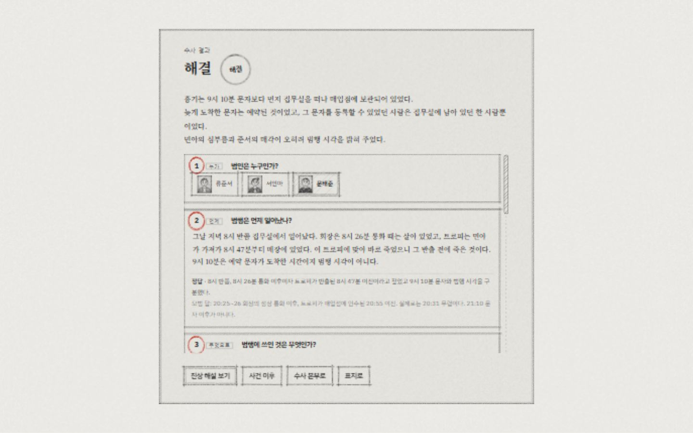
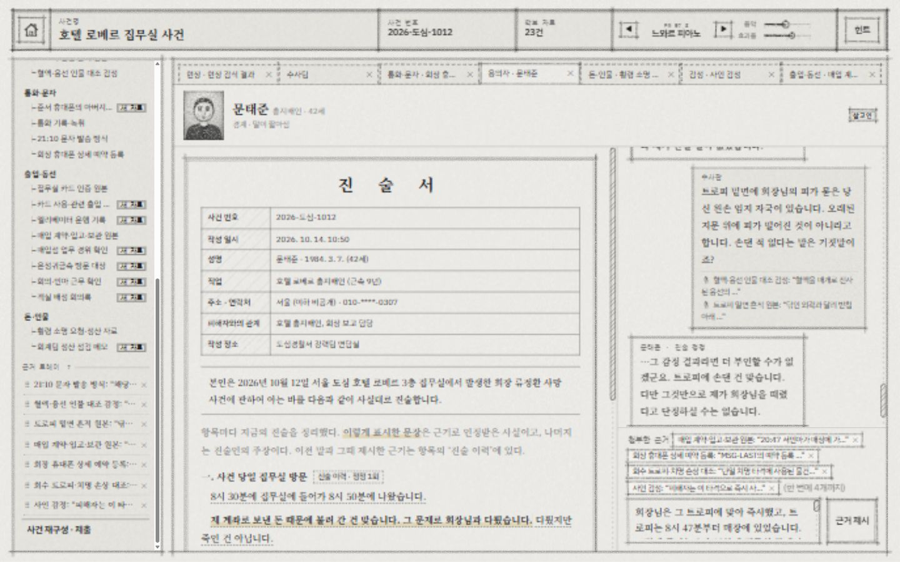

# 호텔 로베르 집무실 사건 — 숙련자·입문자 2회 플레이 리뷰

2026-10-15 · 로컬 최신 화면(http://localhost:5173/)에서 플레이 · 스포일러 포함

## 결과

| 모의 플레이어 | 집중한 부분 | 리뷰 점수 | 사람 속도로 진행한 완료 시간 | 게임 결과 |
|---|---|---:|---:|---|
| 추리게임 숙련자 | 트릭, 증거의 공정성, 자유 질문과 판정 시스템 | **7.5 / 10** | **27분 44초** | 문태준 지목 성공, 서술 5문항 모두 정답 |
| 추리게임 입문자 | 가족 관계, 행동 이유, 사건의 개연성과 현실성 | **7.0 / 10** | **46분 30초** | 문태준 지목 성공, 서술 5문항 모두 정답 |

가장 좋은 부분은 **허락받은 심부름과 매각이 흉기를 현장 밖으로 옮겨, 범행 시각을 거꾸로 밝혀 준다**는 연결이다. 가장 아쉬운 부분은 **대화에서 이해한 내용과 진술서·힌트가 기억하는 내용이 어긋나, 같은 질문을 다시 하게 되는 순간**이다.

[129개 선택의 이유·현재 판단·흥미도 전체 기록](</design/playtest-2026-10-15/decisions.md>) · [시간 산출 기록](</design/playtest-2026-10-15/timing.json>) · [선택 원자료](</design/playtest-2026-10-15/decisions.json>)

## 진행 방식과 해석의 한계

실제 사람 두 명을 모집한 실험이 아니라, 두 성향의 첫 방문자를 모의한 플레이다. 환경 확인 중 README에서 사건의 핵심 설정을 보았고 이전 프로젝트 맥락도 알고 있었다. 둘째 판 역시 첫 판의 정답을 아는 상태에서 입문자 행동을 모의했다. 따라서 발견 속도·자력 해결률을 실제 처음 하는 사람의 데이터로 읽으면 안 된다. 선택의 자연스러움, 도움 기능, 대화 일관성, 조작 마찰을 확인한 기록으로 보는 것이 맞다.

두 판 모두 새 상태에서 시작했다. 숙련자는 객관 기록을 먼저 의뢰하고, 입문자는 인물의 행동 이유를 먼저 물었다. 읽기에는 대체로 25~55초, 판단과 입력 준비에는 15~40초를 실제로 기다렸다. 입력 자체는 자동화했지만, 종료 후 시간을 배수로 곱하거나 임의로 늘리지 않았다. 완료 시간은 수사 시작부터 최종 채점 확인까지이며 표지 탐색·후일담·리뷰 작성은 제외했다.

첫 판의 브라우저 연결 중단 구간은 제외했다. 입문자 판의 전체 벽시계 경과는 4시간 26분 34초였지만, 진행이 멈췄던 **3시간 38분 42초**와 서버 복구 **1분 22초**를 빼면 실제 활동은 **46분 30초**다. 이 긴 중단 중에도 게임 내부 자동 조사는 계속 진행됐다. 복귀 시 자료가 20건 쌓인 현상은 중단의 영향을 받았으므로, 연속 플레이에서도 똑같이 쌓인다고 단정하지 않는다.

첫 판 최종 채점은 로컬 서버 종료로 AI 연결이 실패해 예비 낱말 채점을 사용했다. 둘째 판 채점은 AI 응답과 문항별 설명을 확인했다. 두 결과를 채점기 성능의 비교 자료로 사용할 수는 없다. 리뷰 점수는 이런 환경 장애 자체를 게임의 이야기 점수로 감점하지 않고, 확인한 플레이 경험을 기준으로 매겼다.

## 숙련자 관점

처음에는 마지막 문자라는 제목을 보고 예약 발송 가능성을 일찍 떠올렸다. 이는 내가 이미 설정을 본 상태라는 영향을 강하게 받으므로, 실제 숙련자도 반드시 같은 속도로 간파한다고 말할 수는 없다. 그래도 문자 도착 시각과 생존 시각을 분리하고, 출입·부검·흉기를 교차 확인하는 플레이는 게임이 받아 줬다.

### 선택과 판단의 변화

1. **객관 기록부터 요청 — 흥미 7/10.** 부검·출입 기록·현장 감식을 한 문장으로 맡겼다. 세 건 모두 접수됐고 기다리는 동안 준서 면담을 진행할 수 있었다. 조사 대기를 다른 행동으로 채우는 흐름이 좋다.
2. **두 문자와 카드 기록의 어긋남 — 8/10.** 매각을 허락한 아버지가 나중에는 무단 매각을 꾸짖는다. 준서는 매입점에 계속 있었다는데 준서 카드가 집무실에 찍혔다. 카드 명의가 사람의 위치는 아니라는 점을 민아 면담으로 확인했다.
3. **즉사·현장 청소·흉기 반출 연결 — 9/10.** 부검은 정확한 사망 분을 주지 않는다. 트로피가 흉기이며 반출 뒤 매장에 계속 있었다는 사실을 연결해야 한다. 이 구간이 가장 만족스러웠다.
4. **태준의 대사와 힌트 사이 — 7/10.** 퇴실 때 생존을 직접 보았는지 여러 번 물었는데 회피적인 답이 이어졌다. 마지막 문자 질문도 대사는 나왔지만 관련 항목과 도움말은 충분히 따라오지 않았다. 무엇을 물어야 게임이 들었다고 인정하는지가 신경 쓰였다.
5. **부분 인정과 최종 추궁 — 8~9/10.** 예약 문자 자료를 제시하자 생존 근거가 못 된다고 인정하고, 예약자는 자신이 아니라고 버텼다. 이어 반출 전 사망과 20:48 현장 예약을 묶자 자백했다. 빠르게 핵심을 모으면 모든 거짓말을 정해진 순서로 깨지 않아도 진행된다는 점이 좋다.
6. **전송 마찰과 보고서 — 일시 6/10, 완료 8/10.** 네 문서 첨부 후 클릭이 전송되지 않아 Enter를 사용했다. 결론을 찾은 뒤에도 다섯 서술 칸을 채우는 시간이 필요해 마무리가 길게 느껴졌다.

### 숙련자가 남기는 리뷰

> 예약 문자 자체의 새로움보다, 흉기가 먼저 밖에 있었다는 사실로 시간을 뒤집는 연결이 좋았다. 자료를 따져 가설을 검증하는 재미는 있다. 다만 중반 이후에는 추리보다 게임의 기록 조건을 맞추고 근거를 옮기는 조작에 신경 쓰게 되는 순간이 있다. 동기는 자백에서 한꺼번에 회수되어, 인물을 파헤치는 재미는 시간 논증보다 약했다.

**7.5/10.** 공정한 짧은 사건으로 즐길 만하다. 더 복잡한 트릭을 추가하기보다, 이미 알아낸 것을 게임이 안정적으로 기억하고 반응하게 만드는 것이 먼저다.

## 입문자 관점

입문자는 아들이 화가 나 올라갔다는 소개를 먼저 받아들였다. 그래서 준서와 아버지의 관계, 심부름을 맡긴 이유, 거래 후 머문 이유부터 물었다. 정답을 모르는 실제 입문자를 재현한 것은 아니지만, 동기와 행동의 납득을 우선하는 질문 경로는 숙련자와 분명히 달랐다.

### 선택과 판단의 변화

1. **인물·발견·평면도 읽기 — 6/10.** 초기 수사 요령에 기능이 많다. 인물 소개는 역할 위주라 깊이는 얕지만, 평면도의 문·시야 설명은 민아가 시신을 못 본 이유를 상상하는 데 도움이 됐다.
2. **4분 자동 보완 — 7/10.** 새 단서 없이 읽고 망설이던 중 수사팀이 통화 내역·녹음 조회를 먼저 시작했다. 이후 대화에 “혹시 도움이 될까 해서 먼저 확인해 뒀다”는 설명과 자료가 생겼다. 자동 보완이 실제로 작동함을 확인했다.
3. **가족과 심부름의 개연성 — 7/10.** 준서는 아버지 얼굴을 보기 껄끄러웠고 부족한 사업 자금을 계산했다고 답했다. 민아는 허락받은 부탁이라 믿었고 회의 준비 때문에 늦게 갔다고 설명했다. 이런 질문에 답이 이어져 사건을 사람의 행동으로 이해할 수 있었다.
4. **돈 문제를 말로 추궁 — 8/10.** 정산 자료를 읽고 “개인 계좌로 돈이 갔는데 정기 보고가 맞느냐”고 첨부 없이 지적했더니 다툼을 인정했다. 자기 말로 진행할 수 있다는 성취가 있었다.
5. **문자 힌트의 반복 — 5~6/10.** 문자에 대해 물어 답을 들었는데도 힌트는 다시 문자에 대해 물으라고 했다. 상세 단계도 직접 보냈다고 생각하는지 물으라는 내용이었다. 그 표현대로 질문해도 새 진술 항목이 보이지 않았다. 다음에 뭘 해야 하는지 도와야 할 기능이 오히려 같은 질문을 반복시키는 구간이었다.
6. **말과 첨부의 판정 차이 — 6~7/10.** 예약 발송 내용을 말로 지적하자 기록을 보여 달라고 버텼고, 자료를 첨부하자 인정했다. 횡령은 말로 인정됐던 직전 경험과 달라 기준을 예측하기 어렵다. 다만 상대가 자료를 요구하는 대사는 다음 행동의 실마리가 됐다.
7. **피 묻은 지문 대조 — 9/10.** 흔적이 누구 것인지 요청하고 원본·대조 감정을 읽었다. 오래된 지문 위에 피가 떨어진 것이 아니라 피 묻은 손가락이 만든 흔적이라는 구분이 설득력 있었다. 다른 두 사람의 외곽 지문도 따로 설명해 억지로 몰아가는 느낌을 줄였다.
8. **시간 기록까지 연결해 자백 — 8~9/10.** 접촉 인정만으로 끝나지 않아 약간 지쳤지만, 흉기 보관 시각과 예약 시각을 비교하자 회장이 직접 썼다는 설명을 배제할 수 있었다. 마지막 연결의 만족감이 회복됐다.
9. **자백 뒤 현실성 질문 — 7~8/10.** 흉기를 제자리에 놓은 이유와 휴대폰 잠금을 물었다. 원래 자리가 덜 눈에 띈다고 생각했다는 설명, 업무상 비밀번호를 알고 있었다는 설명은 납득 가능했다. 다만 흉기가 어떤 물건인지 신경 쓸 겨를도 없었다는 대사는 앞서 그 물건으로 범행하고 청소했다는 사실과 어색하게 충돌한다.
10. **보고서와 후일담 — 작성 중 7/10, 후일담 8/10.** 다섯 답안을 나누는 작업은 기억 정리 부담이 있다. 쉬운 말로 적은 답은 모두 받아들였다. 준서의 죄책감과 민아의 충격이 마지막에 사람의 이야기로 남아 좋았다.

### 입문자가 남기는 리뷰

> 처음엔 아들이 수상했는데, 이야기를 들을수록 화가 난 이유는 이해됐다. 직원이 심부름을 맡은 이유와 왜 시신을 못 봤는지도 설명되어 있었다. 피 묻은 지문을 확인한 순간에는 내가 직접 잘못된 말을 찾아냈다는 기분이 들었다. 힌트와 수사팀 도움은 필요했지만, 같은 질문을 반복하게 하거나 말로 설명했을 때와 자료를 붙였을 때 반응이 달라 헷갈렸다. 후일담은 좋았고, 마지막 보고서는 조금 길었다.

**7.0/10.** 가족과 직원들의 행동은 대체로 이해된다. 설정 부족보다, 대화 표현과 진행 기록의 일관성이 몰입을 더 크게 흔들었다.

## 보완 기능에 대한 실제 평가

| 기능 | 관찰한 동작 | 평가 |
|---|---|---|
| 4분 동안 새 진전이 없을 때 자동 조사 | 첫 4분 직후 통화 조회가 시작됐고 결과가 자료함에 들어왔다. 코드도 4분 기준과 8초 후 결과를 정의한다. | 요청할 조사 이름이 떠오르지 않는 입문자에게 효과적이다. |
| 장기 정체 중 추가 조사 | 중단 중에도 여러 조사와 보너스 자료가 도착했다. | 막힘은 풀리지만 복귀 시 읽을 자료가 쌓인다. 정상 연속 플레이의 양과 동일하다고 볼 수는 없다. |
| 단계별 힌트 | 질문 대상 → 질문 주제로 구체화되고, 논파 성공 뒤에는 다음 단계로 바뀌었다. | 방향성은 좋다. 이미 대답을 들은 주제를 반복한 사례는 우선 점검이 필요하다. |
| 결과 알림·새 자료 표시 | 알림이 사라진 뒤에도 자료함에서 결과를 열 수 있었다. | 천천히 읽는 사람에게 유효하다. |
| 앞서 낸 근거의 누적 | 지문·예약을 각각 제시한 뒤, 새 시간 근거를 추가해 최종 자백을 받았다. | 모든 근거를 다시 붙이지 않고 추궁을 이어갈 수 있다. |
| 자기 말로 쓰는 최종 답안 | 전문 명칭·정확한 20:31을 쓰지 않은 입문자 답도 전부 정답이었다. | 핵심을 이해했는지 평가하는 방향은 적절했다. |

## 먼저 검토할 개선점

| 우선도 | 실제 관찰 | 검토할 변경 | 완료 기준 |
|---|---|---|---|
| 높음 | 네 건을 붙인 최종 반박에서 두 판 모두 클릭 후 입력과 첨부가 남았다. Enter는 성공했다. 두 번째는 1440×900에서도 발생했고 버튼 중앙에는 실제 BUTTON이 있었다. | 입력·첨부 변경 뒤 클릭 처리와 화면 재배치를 점검한다. 원인은 아직 확정하지 않았다. | 네 건 첨부 후 첫 클릭으로 대화에 한 번만 올라가고 첨부가 비워진다. 자동 조작 영향인지도 분리 확인한다. |
| 높음 | 문자 질문에 충분한 대사가 나왔는데 진술서와 힌트는 같은 질문을 다시 요구했다. | 생성된 대사에서 인정한 주제와 준비된 답 ID·진술 기록·힌트 조건을 함께 갱신한다. | 동의어·짧은 질문·여러 질문에 답한 뒤에도 이미 답한 사실을 다시 물으라고 하지 않는다. |
| 중간 | 횡령은 말로 정정됐고 예약 문자는 첨부 후 정정됐다. | 무엇이 부족한지 상대의 대사나 수사 수첩에서 일관되게 알려 준다. | 논리가 틀린지, 원본이 없는지, 첨부가 필요한지 구분할 수 있다. |
| 중간 | 자백 뒤 흉기를 어떤 물건인지 신경 못 썼다는 설명이 나왔다. | 자백 이후에도 확정된 범행·청소·반출 인식을 보존하도록 대사 검사를 보강한다. | 후속 왜 질문이 고정된 진상과 충돌하지 않는다. |
| 중간 | 결론을 찾은 뒤 서술 다섯 칸을 따로 작성하면서 흥미가 낮아졌다. | 질문별로 요구하는 핵심을 짧게 보여 주고, 기존 진술과 자료를 다시 확인하기 쉽게 한다. | 정답을 대신 채우지 않아도 플레이어가 같은 사건을 여러 번 장황하게 설명할 필요가 줄어든다. |
| 낮음 | 긴 중단 뒤 자료가 20건 쌓여 읽을 순서를 고르기 어려웠다. | 복귀 시 미열람 결과와 다음 조사 한 건을 짧게 묶어 안내하는 방식을 검토한다. | 자료를 주는 보완이 새로운 읽기 부담으로만 느껴지지 않는다. |

이 항목들은 리뷰 제안이다. 게임 코드는 수정하지 않았다.

## 플레이 후 코드·설정으로 확인한 것

- 휴대폰 비밀번호를 태준이 업무상 알고 있었다는 것은 즉석으로 새로 지은 핑계가 아니었다. 설정집과 준비된 답에 이미 있다. 따라서 잠금은 사건의 논리 구멍으로 분류하지 않는다.
- 태준은 민아가 흉기를 가져갈 때 속으로 다행이라고 생각했다는 설정이 고정되어 있다. 이번 자백 후 대사의 “그 물건인지 신경 쓸 겨를도 없었다”는 표현은 이 인식을 흐린다. 설정을 바꿀 문제보다 대사 일관성 문제다.
- 힌트는 마지막 문자 주제의 준비된 답 ID C-Q10 보유 여부를 직접 확인한다. 화면 대사가 나왔어도 이 ID가 기록되지 않으면 같은 질문이 반복될 수 있다. 내부 해석 결과 ID를 이번에 별도로 계측하지 않았으므로 정확한 누락 원인은 추정이다.
- 자동 보완은 진행 중인 조사가 없을 때 다음 조사 하나를 고르고, 진행 조건이 있는 핵심 조사는 자동 선택에서 제외한다. 이번에도 최종 추궁을 수사팀이 대신하지는 않았다.

참조 위치: [힌트 조건](</src/engine/hints.ts#L111>), [4분 자동 보완](</src/engine/investigation.ts#L141>), [전송 처리](</src/ui/Interrogation.tsx#L32>), [비밀번호 답변](</src/data/answers.ts#L196>), [자백 뒤 사실](</src/data/bible.ts#L133>), [사건 설정](</design/hotel-gold-trophy-case.md#L76>). 이 위치들은 플레이가 끝난 뒤 관찰의 해석을 확인하기 위해 읽었다.

## 기록과 화면

- decisions.md: 숙련자 54개, 입문자 75개 선택 각각의 이유·현재 판단·흥미도.
- decisions.json: 위 기록의 구조화 원자료.
- resumed-playlog.json: 재개 이후 화면 원문과 그때 남긴 메모. 중단 전 선택은 세션 도구 기록에서 복원했다.
- timing.json: 실제 완료 시각, 제외 구간, 산식.
- novice-result.txt: 입문자 판 최종 결과 화면의 전체 텍스트.
- four-evidence-submit.png: 네 건 첨부 후 클릭했는데 입력이 남은 순간.
- expert-result.png: 첫 판 결과 화면. 연결 복구 뒤 좁은 창에서 찍혀 일부가 잘렸으므로 결과 전체 텍스트를 대신하는 증거로 사용하지 않는다.

두 판을 합쳐 보면, 단서를 더 복잡하게 만드는 것보다 **플레이어가 이미 이해하고 말한 것을 진술서·힌트·다음 대사가 같은 사실로 기억하게 하는 것**이 만족도를 더 크게 올릴 변경이다.
