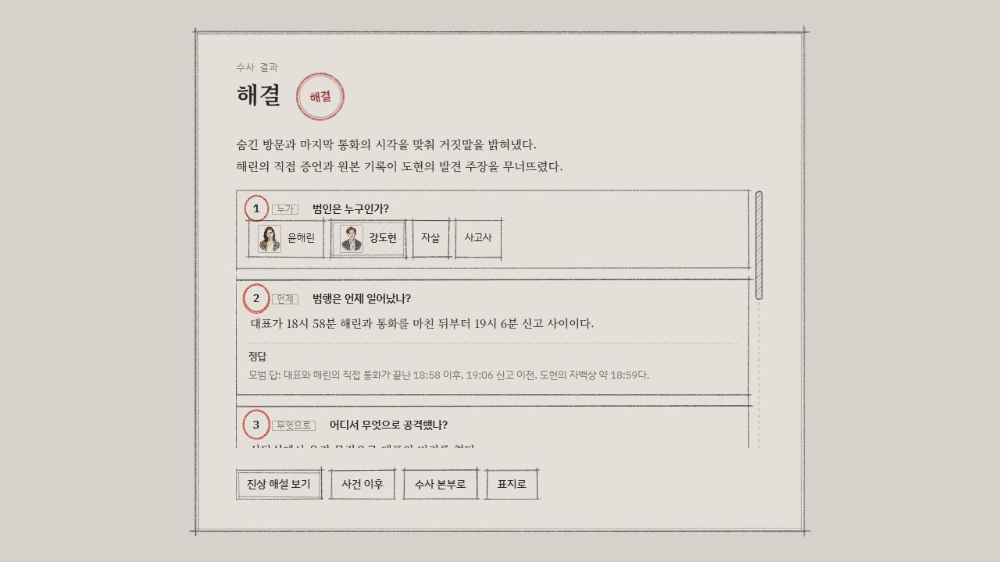

# 2026-10-18 배포 검증

결과: **Firebase Hosting과 `ai` 함수 배포 완료, 실제 사이트 검증 통과.**

## 대상과 변경

- 작업 폴더: 저장소 루트
- Firebase 프로젝트: `crime-case-file` (`.firebaserc` 및 Hosting 사이트 목록으로 확인).
- 실제 주소: https://crime-case-file.web.app
- 배포 대상: `hosting,functions:ai`. 기존 `log`·`logs` 함수는 이번 배포 대상으로 지정하지 않았다.
- 포함 변경: 튜토리얼 이야기·생성 대사·진술 정리 수정, tutorialGrade/tutorialStatement/tutorialHint 작업 추가, 튜토리얼 예상 약 5분·에피소드 1 예상 약 40~50분 표시.

## 배포 전 검증

- `npm.cmd test`: 81개 통과, 실패 0개.
- `npm.cmd run build`: 성공. 기존 번들 크기와 동적 import 경고는 남아 있다.
- `npm.cmd --prefix functions run build`: 성공.
- Firebase CLI의 Functions predeploy 빌드도 성공.

첫 배포는 로컬 Functions 백엔드 분석에서 기본 10초 제한을 넘겨 중단됐다. 새 버전을 공개하기 전의 실패였다. [Firebase 공식 초기화 시간 제한 안내](https://firebase.google.com/docs/functions/tips#avoid_deployment_timeouts_during_initialization)에 따라 배포 프로세스에만 `FUNCTIONS_DISCOVERY_TIMEOUT=60`을 설정하고 재시도했다. 함수의 요청 시간 제한이나 인증 설정은 바꾸지 않았다.

재시도 명령:

```powershell
$env:FUNCTIONS_DISCOVERY_TIMEOUT='60'
firebase.cmd deploy --project crime-case-file --only "hosting,functions:ai" --non-interactive
```

CLI에서 `functions[ai(asia-northeast3)] Successful update operation`, `hosting[crime-case-file]: release complete`, `Deploy complete!`를 확인했다.

로그: `dev-logs/release-2026-10-18-tests.log`, `release-2026-10-18-build.log`, `release-2026-10-18-deploy.log`, `release-2026-10-18-deploy-retry.log`.

## 실제 사이트 검증

1. 사건 선택 화면에서 **튜토리얼 예상 약 5분**, **에피소드 1 예상 약 40~50분** 표시를 확인했다.
2. 실제 페이지가 불러온 `/assets/index-BipzxS5l.js`가 로컬 빌드 파일과 SHA-256까지 일치했다. 해시는 `A4FD8D0DA0E4A599D2691C73B898544312C6144830DBD15EBCF052802842F7E2`다. `live-assets.json`에 비교 결과를 보관했다.
3. `/api/ai` 상태 확인은 HTTP 200이며 공급자는 Claude·OpenAI로 응답했다.
4. 기존 본편 저장에는 새로 시작을 실행하지 않고, 저장이 없던 튜토리얼에서 새 판을 시작했다. 해린에게 마지막 연락·이체 내역을, 도현에게 행적을 묻고 수사팀에 출입·통화·감식을 요청했다.
5. 출입 기록으로 18:53 방문을 인정받았다. 실제 대사는 그때 이미 상담실 바닥에서 숨져 있었다는 수정된 주장이었다. 이후 통화 기록으로 추궁해 공격·지문 제거·발견자 위장·도어록 기록을 생각하지 못한 이유까지 자백받았다.
6. 진술서가 실제 답변을 정리하고, 힌트도 화면에 표시됐다. `tutorialTalk`, `tutorialDesk`, `tutorialStatement`, `tutorialHint`의 서버 HTTP 200 응답을 관찰했다.
7. 한 문장씩 사건 재구성을 작성해 제출했다. **해결 판정 및 서술형 4개 모두 정답**을 받았다. `tutorialGrade` 요청은 HTTP 200이었고 본부의 결과 화면에 ‘채점관에 닿지 못해 낱말로 채점했다’ 문구가 없었다. AI 의미 채점이 사용된 것으로 확인했다.
8. 라이브 확인 중 수집한 콘솔 경고·오류는 0개였다.

이 검증은 정답을 알고 진행한 배포 후 기능 점검이다. 에피소드 1 전체를 다시 플레이하거나, 처음 접하는 사용자의 플레이타임을 검증한 것으로 간주하지 않는다.

## 증거 파일

- `episodes.jpg`, `episodes.txt`: 실제 선택 화면의 플레이타임 표시.
- `live-assets.json`: 배포 번들과 로컬 빌드의 일치 여부.
- `ai-network.json`: 관련 AI 요청의 작업 이름·응답 코드만 기록. 인증 헤더나 토큰은 저장하지 않았다.
- `live-haerin-statement.txt`, `live-first-correction.txt`, `live-confession.txt`: 실제 대사와 진술서.
- `live-grade-result.txt`, `live-semantic-grade-confirmed.txt`, `tutorial-result.jpg`: 실제 해결·채점 결과.
- `console-warnings.json`: 빈 배열.



